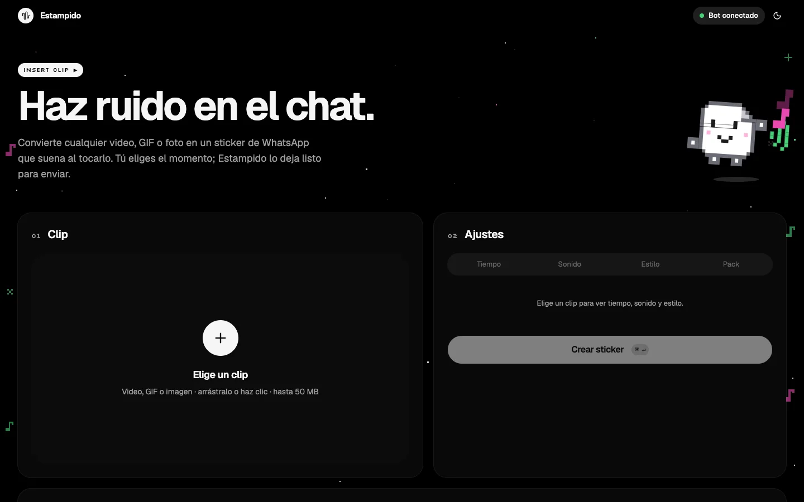

# 🔊 Estampido

> **Haz ruido en el chat.** Convierte cualquier video, GIF o foto en un sticker de WhatsApp que suena al tocarlo.

_Estampa + estampido._ Estampido genera **stickers con sonido nativos** de WhatsApp (el formato de _sound stickers_ en despliegue desde nov 2026) y los envía a tu chat. Puedes usarlo desde una **web**, un **bot de WhatsApp**, una **CLI** o su **API**.

[](https://github.com/IsrraDex36/Estampido-V1/actions/workflows/ci.yml)




## Qué hace

- **Video → sticker animado con su propio sonido.** Eliges el tramo, hasta **3 min**.
- **Imagen, GIF o sticker + tu audio**, por ejemplo una nota de voz. Con imagen, hasta 10 s de sonido.
- **Graba tu voz desde la web** (micrófono) y úsala como sonido del sticker, con medidor de nivel en vivo.
- **Sticker con sonido nativo** (`audioStickerMessage`, campo 134), validado en teléfono real. Si falla, envía el sticker y una nota de voz por separado.
- **Siempre dentro del límite de WhatsApp**: WebP 512×512 de ≤ 500 KB (estáticos ≤ 100 KB), con frames uniformes. El modo **«Calidad alta»** (`hq`) sube hasta 5 MB, pero es experimental.
- **Sonido robusto**: elige la pista correcta, recorta los silencios, nivela el audio bajito (hasta +20 dB) y alinea el audio con la imagen.
- **Metadatos de pack y autor** (EXIF de WhatsApp) y emojis.

## Web

`npm run dev` → <http://localhost:5173>

1. **Clip**: arrastra un video, GIF o imagen. Marca el tramo con el control de rango o escribiendo los tiempos en `m:ss`.
2. **Ajustes**: pestañas Tiempo, Sonido (el del video, un audio propio o **🎙️ grabar tu voz**: hasta 30 s; con imagen, 10 s), Estilo (encuadre `crop`/`pad`, Calidad alta) y Pack (nombre, autor, emojis).
3. **Resultado**: lo escuchas ahí mismo, lo descargas, lo compartes o lo **envías a tu WhatsApp** con sonido.
   - La primera vez se **vincula tu WhatsApp con un código**: un botón abre WhatsApp con el código ya escrito, solo tocas Enviar, y la web lo detecta y envía el sticker sola.
   - Cualquier persona puede vincular el suyo; cada navegador envía solo a su chat. Detalles en [docs/ENVIO.md](docs/ENVIO.md).
4. **Colección**: cada sticker que creas se guarda en la sesión. Selecciona varios y **envíalos todos a la vez**: llegan en orden y con sonido, con barra de progreso y opción de cancelar.

Otros detalles: tema claro/oscuro (negro puro), atajo `⌘/Ctrl + Enter` para crear el sticker, carga real y cancelación (que también detiene FFmpeg en el servidor). Es responsive desde el móvil hasta monitores de 27″, con fondo pixel-art y Pum, la mascota.

> **¿Y los packs de stickers nativos?** El formato de pack de WhatsApp (`stickerPackMessage`) **no admite audio**: los stickers llegarían mudos. Por eso la Colección envía varios stickers con sonido uno tras otro. La investigación y el modo de captura de packs están en [docs/PROTOCOLO.md](docs/PROTOCOLO.md).

## Comunidad

En `/comunidad` (pestaña **Comunidad** del encabezado) los stickers que publicas forman una biblioteca de **sonidos reutilizables**:

- **Publicar**: en el Resultado, el botón «Publicar» pide categoría, título, etiquetas y que confirmes que el audio es tuyo o que tienes permiso.
- **Combinar sonidos con tus clips**:
  - En la comunidad, el botón **«Usar»** te lleva a Crear con ese sonido ya cargado (`/?sonido=<id>`). Solo te falta elegir tu video, GIF, imagen o sticker.
  - Desde Crear, en la pestaña Sonido, el botón **«Comunidad»** abre un selector con búsqueda, escucha previa y paginación.
  - Cada uso cuenta para «Sonidos virales» y para el ranking. Si publicas lo que hiciste con un sonido de la comunidad, queda enlazado a su origen.
- **Feed paginado de verdad**: Tendencias, Nuevos y Top (Hoy, Semana, Siempre), con 17 categorías y búsqueda (no distingue acentos).
  - Paginación por cursor estable, sin duplicados ni huecos aunque se publique mientras navegas.
  - Scroll infinito, con un botón «Cargar más» de respaldo.
  - Skeletons mientras carga.
  - Los filtros viven en la URL (`?orden=top&cat=memes&q=gato`), así que puedes compartir o recargar una vista filtrada.
  - Al pasar el mouse por «Comunidad» se precargan el código y los datos: al hacer clic aparece al instante.
- **URLs a prueba de todo**:
  - Mayúsculas, barras de más y alias (`/crear`, `/community`) llevan a la URL correcta.
  - Los parámetros desconocidos o inválidos se descartan sin romper nada.
  - Las rutas que no existen muestran un 404.
  - Si una página falla, aparece un aviso con «Reintentar» en lugar de una pantalla en blanco.
- **Top de la semana** (podio) y **Sonidos virales**. Toca cualquier sticker o sonido para escucharlo: nunca se reproduce solo y suena uno a la vez.
- **Favoritos**: guarda stickers y sonidos con el marcador. Los ves en «Tu espacio» (Guardados, Sonidos, Publicados); se guardan en este dispositivo.
- Los datos se guardan en `.data/community` (persistente y fuera de git; otra ruta con `SVA_COMMUNITY_DIR`). Todavía no hay cuentas ni votos. El reto semanal, los packs y los creadores siguen como «Pronto».

El análisis completo (perfiles, flujos, ranking, modelo de datos, API, moderación y fases) está en [docs/COMUNIDAD.md](docs/COMUNIDAD.md).

## Bot de WhatsApp

Funciona con [Baileys](https://github.com/WhiskeySockets/Baileys) (no oficial; ver [Riesgos](#riesgos)). Envía o responde un video, GIF, imagen o sticker con:

| Comando                | Qué hace                                 |
| ---------------------- | ---------------------------------------- |
| `/saudio`              | Video completo, hasta 3 min              |
| `/saudio 0:12 5`       | Desde 0:12, durante 5 s                  |
| `/saudio pad` / `crop` | Encuadre: con bordes o recortado         |
| `/saudio voz`          | Usa la siguiente nota de voz como sonido |
| `/saudio hq`           | Calidad alta, hasta 5 MB (experimental)  |
| `/cancelar`            | Detiene lo que esté en curso             |
| `/ayuda`               | Muestra la ayuda                         |

Muestra el progreso en un solo mensaje que se va editando y te dice tu posición en la cola. Tiene límite de usos por persona y, si el bot corre en tu propio número, puede responder solo en tu chat contigo mismo.

## Calidad y fluidez

El optimizador busca primero la mayor cantidad de **fps** posible:

1. Codifica una muestra de ≤ 4 s y estima cuánto pesará el clip completo.
2. Si cabe, usa la mejor calidad a fps completos (máx. 15, sin duplicar frames de la fuente).
3. Si no cabe, calcula cuántos fps entran en el presupuesto y luego verifica con el clip completo.

libwebp usa el preset `picture`: a la misma calidad pesa ~5–10 % menos, lo que da ~1 fps más sin tardar más. El audio va en un archivo Opus aparte (48 kbps; 32 kbps para clips de más de 30 s), así que no ocupa espacio del sticker.

| Clip | fps típicos        |
| ---- | ------------------ |
| 5 s  | 15                 |
| 10 s | 8–11               |
| 30 s | 3–4 (más con `hq`) |

## Requisitos

- **Node.js ≥ 24**
- **FFmpeg** con `libwebp_anim` y `libopus`, y decodificador de WebP animado (FFmpeg ≥ 8)
  - macOS: `brew install ffmpeg-full`
  - Otra ruta: `FFMPEG_PATH` / `FFPROBE_PATH`

## Uso rápido

```bash
npm install && npm --prefix web install
npm run check-deps        # verifica ffmpeg/ffprobe y encoders

npm run dev               # API :8787 + web :5173
npm run bot               # bot (lee .env); la primera vez muestra un QR o código para vincular

# CLI
npm run cli -- convert video.mp4 -s 2 -d 4 -o out/      # tramo 0:02–0:06 con su audio
npm run cli -- convert video.mp4 -a voz.ogg --crop      # audio propio
npm run cli -- convert foto.png -a voz.ogg              # imagen + sonido (≤ 10 s)
npm run cli -- convert anim.gif -a voz.ogg              # GIF + sonido
npm run cli -- convert video.mp4 --pack "Mis memes" --author Yo --emoji 😂,🔊
npm run cli -- doctor
```

### Publicarlo en internet (prueba)

```bash
brew install cloudflared      # una vez
npm run start:public          # compila la web, arranca la API en producción + el bot + un túnel de Cloudflare
```

En la consola aparece `🌍 URL pública: https://….trycloudflare.com`: compártela. Esa URL **cambia cada vez que reinicias**.

- En producción, la API sirve la web y la API desde un solo puerto. Aplica límites por IP, cabeceras de seguridad (CSP con hash, sin scripts inline), **exige WhatsApp vinculado para publicar** y pone un tope de espacio a la comunidad.
- La API solo escucha en `127.0.0.1`: la única entrada pública es el túnel.
- La Mac se mantiene despierta mientras corre (`caffeinate`) y cada proceso se reinicia solo si se cae.
- Sin túnel: `npm run start` (producción local en <http://127.0.0.1:8787>).
- ⚠️ Mientras el bot use tu número personal, quien use la web lo verá en el enlace de WhatsApp.

### Desplegar en Railway (24/7, URL fija)

Un solo servicio con Docker (web, API y bot) y un volumen en `/data`. Paso a paso en [docs/DEPLOY-RAILWAY.md](docs/DEPLOY-RAILWAY.md).

### Configuración del bot (`.env`)

Copia [`.env.example`](.env.example) a `.env`:

| Variable                  | Para qué                                                        |
| ------------------------- | --------------------------------------------------------------- |
| `SVA_ALLOWED`             | Números que pueden usar `/saudio` (con código de país, sin `+`) |
| `SVA_PACK` / `SVA_AUTHOR` | Pack y autor por defecto (autor = tu nombre de WhatsApp)        |
| `SVA_FIT`                 | Encuadre por defecto: `crop` o `pad`                            |
| `SVA_SEND_MODE`           | `native`, `fallback` o `both`                                   |
| `SVA_RATE_PER_MIN`        | Máx. `/saudio` por persona y minuto (`0` = sin límite)          |
| `SVA_SELF_CHAT_ONLY`      | `1`: solo responde en tu chat contigo mismo                     |

## Scripts

| Script                        |                                                                                                  |
| ----------------------------- | ------------------------------------------------------------------------------------------------ |
| `npm run dev`                 | API + web en modo desarrollo                                                                     |
| `npm run bot` / `bot:capture` | Bot; `capture` también guarda los mensajes desconocidos (sound stickers, packs) para analizarlos |
| `npm run cli`                 | CLI `sva`                                                                                        |
| `npm test`                    | Pruebas unitarias y de integración (Vitest, FFmpeg real)                                         |
| `npm run test:e2e`            | Pruebas en navegador real (Chrome/Brave/Chromium; `CHROME_PATH` para otro)                       |
| `npm run lint` / `typecheck`  | Biome + oxlint (web) / TypeScript                                                                |
| `npm run build` / `build:web` | Compila la API, la CLI y el bot / compila la web                                                 |

La **CI** (GitHub Actions) corre lint, tipos, tests, el build de la web y las pruebas en navegador en cada push.

## Arquitectura

Arquitectura hexagonal: un **núcleo** puro de conversión, un **pipeline** que lo orquesta y **adaptadores** delgados para cada forma de uso.

```
src/
├── core/        probe · video · audio · image · frame · optimize (fps-first) · metadata (EXIF) · webp
├── pipeline/    convertToSoundSticker: valida, extrae el sonido, optimiza, agrega metadatos y cancela
├── adapters/
│   ├── http/    API Hono: /api/convert, resultados, envío a WhatsApp
│   ├── bot/     Baileys: /saudio, sticker con sonido nativo (campo 134), cola, captura
│   └── cli/     sva convert · sva doctor
├── config/      límites y rutas
└── utils/       ffmpeg, semáforo cancelable, protobuf crudo, tiempos
web/src/
├── app/         header, footer, rutas, providers (QueryClient, tema, <Toaster /> global)
├── lib/
│   ├── api.ts       transporte (readJson + ApiError)
│   ├── notify.ts    única puerta a los avisos (Sonner)
│   └── query/       createQueryClient (errores globales) · query keys jerárquicas
├── features/
│   ├── converter/   flujo de conversión (zustand), grabar voz, sonidos de la comunidad, publicar
│   ├── collection/  colección de la sesión + envío por lotes
│   ├── community/   api/ (endpoints · queries · mutations) + stores (filtros↔URL, favoritos, reproductor)
│   └── bot/         api.ts: estado del bot (useQuery con sondeo) y envío (useMutation)
└── components/  UI (shadcn), íconos (Phosphor, en un solo módulo), pixel art (fondo, mascota Pum), tema
tests/  unit · integration · web (hooks con renderHook)       e2e/  navegador real
```

**Estado en la web**: **TanStack Query** se encarga del estado del servidor (lecturas en caché, paginación infinita, mutaciones con invalidación) y **Zustand** del estado del cliente (filtros, favoritos, reproductor, flujo de conversión). Todos los avisos pasan por `notify` (Sonner). Las decisiones y el plan por fases están en [docs/ESTADO.md](docs/ESTADO.md).

Más detalle en [docs/PLAN.md](docs/PLAN.md) (fases), [docs/PROTOCOLO.md](docs/PROTOCOLO.md) (formato del sticker con sonido y de los packs) e [INVESTIGACION.md](INVESTIGACION.md).

## Privacidad y seguridad

- Los archivos se borran a los **30 min**. La API solo escucha en `127.0.0.1`.
- El servidor de control del bot usa un token local (`.auth/control.json`, permisos `0600`) y solo envía a tu propio chat.
- **Nunca subas** `.env`, `.auth/` ni `captures/`: contienen claves de sesión y claves de medios. Ya están en `.gitignore`.

## Riesgos

- El formato de los sound stickers **no está documentado por Meta** y puede cambiar sin aviso.
- Baileys es una librería no oficial: **existe riesgo de que baneen el número**. Usa un número secundario.
- El despliegue es parcial: algunos receptores pueden ver el sticker sin sonido.
- Respeta los derechos del audio de terceros.

---

Desarrollado por [@IsrraDex36](https://github.com/IsrraDex36).
