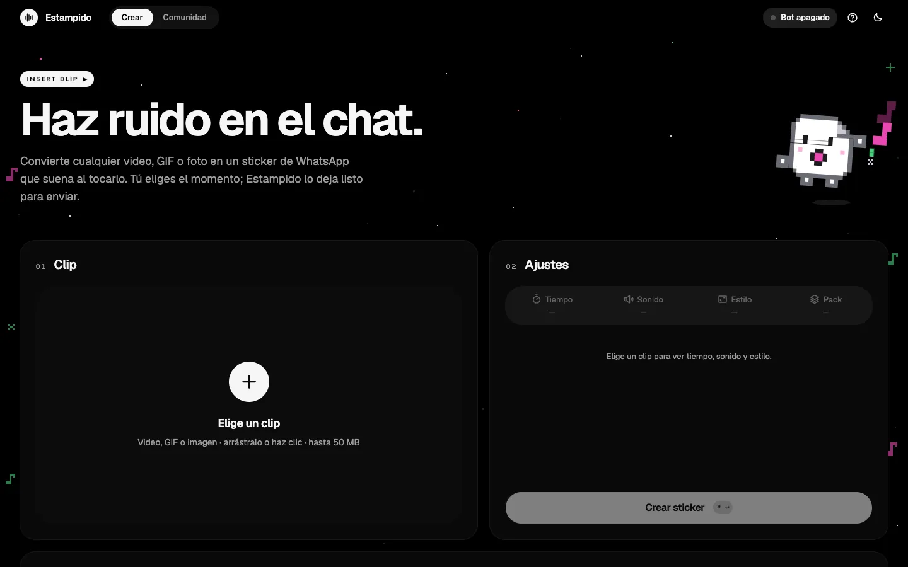
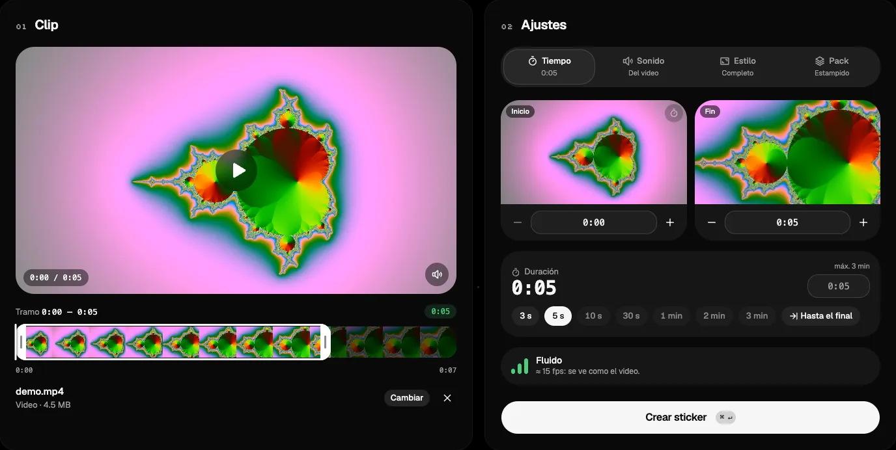
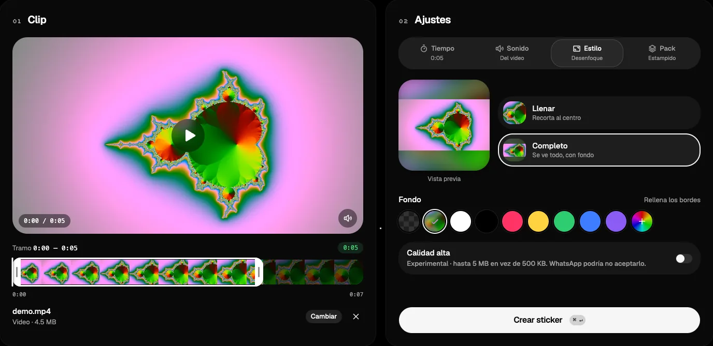
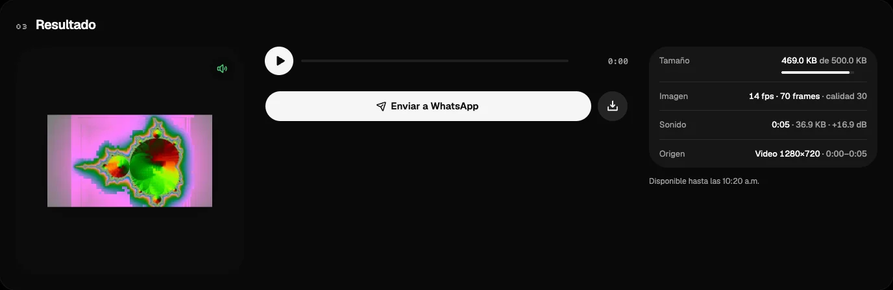
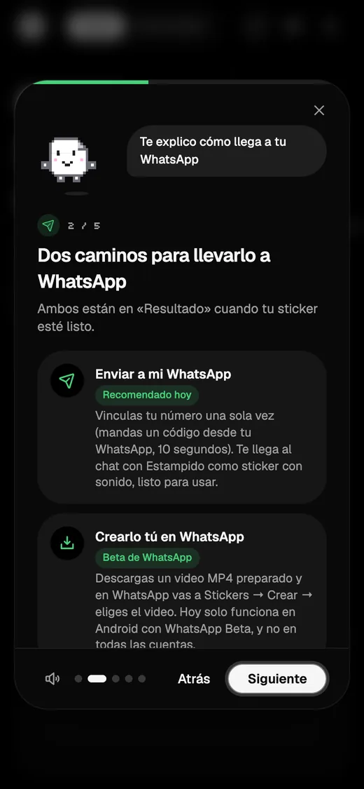
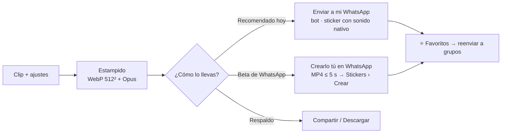
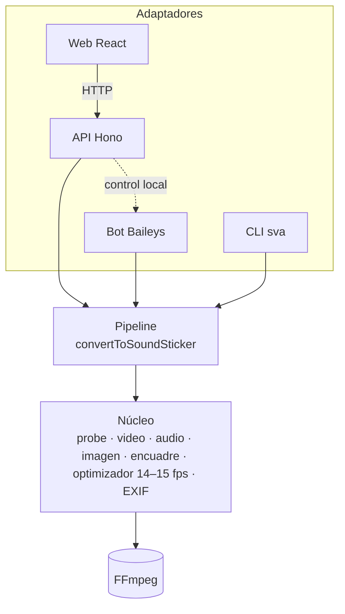

<div align="center">


# Estampido

**Haz ruido en el chat.** Convierte cualquier video, GIF o imagen en un **sticker de WhatsApp que suena al tocarlo**.

[](https://github.com/IsrraDex36/Estampido-V1/actions/workflows/ci.yml)


[](https://github.com/IsrraDex36/Estampido-V1)

[Características](#-características) · [Cómo llega a WhatsApp](#-cómo-llega-a-whatsapp) · [Inicio rápido](#-inicio-rápido) · [Despliegue](#-despliegue) · [Arquitectura](#-arquitectura) · [Documentación](#-documentación)



</div>

---

## ✨ Qué es

_Estampa + estampido._ Estampido genera **stickers con sonido nativos** de WhatsApp, el formato que WhatsApp empezó a desplegar en noviembre de 2026, y te los entrega en tu chat. Es una **web** completa (editor, comunidad y colección), con un **bot de WhatsApp**, una **CLI** y una **API HTTP** sobre el mismo núcleo de conversión.

|                    Editor: recorte, cuadros de inicio y fin, fluidez                     |                    Estilo: encuadre libre, fondos y vista previa en vivo                     |
| :--------------------------------------------------------------------------------------: | :------------------------------------------------------------------------------------------: |
|  |  |

|                                          Resultado: dos caminos a WhatsApp                                          |                             Tour de bienvenida con Pum                              |
| :-----------------------------------------------------------------------------------------------------------------: | :---------------------------------------------------------------------------------: |
|  |  |

## 🚀 Características

### Editor

- **Recortador estilo WhatsApp/Instagram**: tira de fotogramas, marco con bordes arrastrables y reproducción en bucle del tramo elegido. Videos de hasta **3 min**.
- **Tiempo preciso**: tarjetas de inicio y fin con el cuadro real, ajuste fino de ±0.1 s, duraciones rápidas y un **medidor de fluidez** que explica el equilibrio con el límite de 500 KB.
- **Sonido a tu gusto**: el del video, **tu voz grabada** desde el navegador, un archivo propio o un **sonido de la comunidad**. Se recorta sobre la forma de onda (hasta 0.5 s) y se escucha antes de crear.
- **Estilo**: «Llenar» con **encuadre libre** (arrastrar y zoom de 1× a 4×) o «Completo» con **fondo** transparente, desenfocado o de cualquier color, todo con **vista previa en vivo**.
- **Texto y emojis**: texto de meme con 18 tipografías, 4 estilos (contorno, sombra, caja, neón) y cualquier color; arrástralo a donde quieras y agrega hasta 6 emojis como capas. La vista previa es el mismo dibujo que se sube.
- **Efectos**: 14 efectos de voz (ardilla, robot, eco, fantasma…) con «Escuchar» antes de crear, y 10 filtros de color más espejo.
- **Restablecer** por pestaña, y varios archivos a la vez (se crean uno tras otro con los mismos ajustes).
- **Pack**: nombre y autor del pack, con una vista que imita la pantalla de WhatsApp (chat + info del sticker). Por defecto invita a quien lo recibe: «Busca o crea más en • estampido.isrradev.com».

### Calidad

- **Siempre dentro del límite de WhatsApp**: WebP de 512×512 y ≤ 500 KB (estáticos ≤ 100 KB), con frames uniformes. Hay un modo **Calidad alta** de hasta 1 MB, solo para descargar (más de 500 KB suele trabarse en WhatsApp). La duración guía a 3–10 s (WhatsApp anima hasta 10 s); lo más largo se marca como «solo para descargar».
- **Estándar de 14–15 fps**: hasta 10 s, si el sticker pesa se ajustan la calidad y la nitidez (el lienzo sigue siendo 512×512), nunca la fluidez. Solo los clips más largos bajan de 14 fps, con aviso.
- **Audio robusto**: elige la pista correcta, recorta silencios, nivela el audio bajo (hasta +20 dB) y lo sincroniza con la imagen.

### Entrega y comunidad

- **Dos caminos a WhatsApp** (ver abajo), más compartir y descargar como respaldo.
- **Colección** de la sesión: selecciona varios stickers y envíalos todos en orden, con sonido, o publícalos juntos con un solo formulario.
- **Social**: seguir creadores (feed «Siguiendo»), packs de hasta 30 stickers con «Enviar todos a mi WhatsApp» (llegan agrupados y con la marca de la app) y etiquetas sugeridas. Los enlaces de packs y perfiles muestran su propia vista previa con sus stickers.
- **Comunidad**: publica sonidos reutilizables, con feed paginado (Tendencias, Nuevos, Top), 17 categorías, búsqueda, favoritos y ranking de sonidos virales. Los datos viven en **SQLite** (integrado en Node, modo WAL): el ranking, la búsqueda y la paginación se resuelven en SQL con índices.
- **Tendencias honestas**: el ranking combina usos del sonido (×3), guardados (×2), envíos (×1.5) y escuchas (×0.2, una por persona al día), con caída por antigüedad. La base de datos recalcula el puntaje sola (triggers) y el ranking en SQL es idéntico bit a bit a la fórmula de referencia.
- **Moderación**: cualquiera puede reportar un sticker; con 3 reportes de personas distintas se oculta hasta que se revisa. En `/admin`: cola de reportes con motivos y notas, mantener, borrar o bloquear al creador (no puede entrar ni publicar; sus stickers se ocultan y vuelven si se le desbloquea).
- **Cuentas con tu WhatsApp, sin contraseñas**: mandas un código al bot y quedas dentro. Perfil de creador (`/u/usuario`, con avatar, descripción y cifras), favoritos sincronizados entre dispositivos, «Mis stickers» para borrar lo tuyo, creadores destacados y borrado total de la cuenta. Sesiones con cookie `__Host-` (HttpOnly, Secure, SameSite=Lax) guardadas con hash; el número nunca llega a la web, solo una clave HMAC que genera el bot.

### Experiencia

- **Tour de bienvenida** con Pum, la mascota en pixel art, y **sonidos sintetizados** en el navegador (sin archivos de audio, libres de derechos).
- Tema claro y oscuro, responsive desde el celular hasta monitores de 27″, atajo `⌘/Ctrl + Enter` y cancelación real (detiene FFmpeg en el servidor).
- **SEO y PWA**: metadatos por ruta, Open Graph para la vista previa en WhatsApp, `sitemap.xml`, `robots.txt`, datos estructurados y app instalable; instalada en Android, aparece en «Compartir» (manda un video o una nota de voz directo a Estampido).

## 📲 Cómo llega a WhatsApp



| Camino                     | Cómo funciona                                                                                                                                                                                                  | Disponibilidad                               |
| -------------------------- | -------------------------------------------------------------------------------------------------------------------------------------------------------------------------------------------------------------- | -------------------------------------------- |
| **Enviar a mi WhatsApp**   | Vinculas tu número una vez con un código (10 s). El bot te envía un **sticker con sonido nativo** (`audioStickerMessage`, campo 134, validado en teléfono real). Si falla, envía el sticker y una nota de voz. | Todos los que ya reciben stickers con sonido |
| **Crearlo tú en WhatsApp** | Descargas un MP4 cuadrado (H.264 + AAC, ≤ 5 s si es video y ≤ 10 s si es imagen) y WhatsApp lo convierte con su creador oficial. Sin vincular nada.                                                            | Android con WhatsApp Beta, por cuenta        |
| **Compartir / Descargar**  | El menú de compartir del celular o los archivos `.webp` / `.ogg` / `.mp4`.                                                                                                                                     | Siempre                                      |

> El análisis completo (riesgos, escalado a muchos usuarios, API oficial, canales) está en [docs/ESCALAR-ENVIO.md](docs/ESCALAR-ENVIO.md).

## ⚡ Inicio rápido

**Requisitos**

- **Node.js ≥ 24**
- **FFmpeg ≥ 8** con `libwebp_anim`, `libopus`, `libx264` y decodificador de WebP animado. En macOS: `brew install ffmpeg-full`; para otra ruta, `FFMPEG_PATH` y `FFPROBE_PATH`.

```bash
git clone https://github.com/IsrraDex36/Estampido-V1.git && cd Estampido-V1
npm install && npm --prefix web install
npm run check-deps     # verifica ffmpeg/ffprobe y sus encoders
npm run dev            # API :8787 + web http://localhost:5173
```

Para el envío a WhatsApp también hace falta el bot: `npm run bot`, que la primera vez muestra un QR o un código para vincular. Configúralo copiando [`.env.example`](.env.example) a `.env`.

> ⚠️ **Nunca corras el bot en dos lugares con el mismo número** (por ejemplo, en local y en producción): las sesiones se pelean y el bot deja de recibir mensajes.

<details>
<summary><b>Bot de WhatsApp: comandos</b></summary>

<br />

Envía o responde un video, GIF, imagen o sticker con:

| Comando                | Qué hace                                  |
| ---------------------- | ----------------------------------------- |
| `/saudio`              | Los primeros 10 s (lo que WhatsApp anima) |
| `/saudio 0:12 5`       | Desde 0:12, durante 5 s                   |
| `/saudio pad` / `crop` | Encuadre con bordes o recortado           |
| `/saudio voz`          | Usa la siguiente nota de voz como sonido  |
| `/saudio hq`           | Calidad alta, hasta 5 MB (experimental)   |
| `/cancelar` · `/ayuda` | Detiene lo que esté en curso · ayuda      |

Muestra el progreso en un solo mensaje que se va editando, dice tu posición en la cola y limita los usos por persona.

</details>

<details>
<summary><b>CLI</b></summary>

<br />

```bash
npm run cli -- convert video.mp4 -s 2 -d 4 -o out/      # tramo 0:02–0:06 con su audio
npm run cli -- convert video.mp4 -a voz.ogg --crop      # audio propio, recortado
npm run cli -- convert foto.png -a voz.ogg              # imagen + sonido (≤ 10 s)
npm run cli -- convert video.mp4 --pack "Mis memes" --author Yo
npm run cli -- doctor                                   # diagnóstico del entorno
```

</details>

<details>
<summary><b>API HTTP</b></summary>

<br />

| Método                 | Ruta                                                   | Descripción                                                                    |
| ---------------------- | ------------------------------------------------------ | ------------------------------------------------------------------------------ |
| `POST`                 | `/api/convert`                                         | Multipart (`media` + `audio` opcional + opciones) → sticker WebP + sonido Opus |
| `GET`                  | `/api/results/:id/sticker.webp` · `sticker.ogg`        | Archivos del resultado (se borran a los 30 min)                                |
| `GET`                  | `/api/results/:id/whatsapp.mp4`                        | MP4 para el creador oficial de WhatsApp (se genera bajo demanda)               |
| `POST`                 | `/api/results/:id/whatsapp`                            | Envía el sticker al chat vinculado                                             |
| `GET` `POST` `DELETE`  | `/api/whatsapp/link`                                   | Vincular o desvincular este navegador con un código                            |
| `GET`                  | `/api/whatsapp/status`                                 | Estado del bot                                                                 |
| `GET` `POST`           | `/api/community/stickers` · `/sounds` · `/stats`       | Comunidad: feed, sonidos, publicar, cifras                                     |
| `GET` `POST`           | `/api/auth/session` · `/api/auth/logout`               | Entrar con el WhatsApp vinculado · cerrar sesión                               |
| `GET` `PATCH` `DELETE` | `/api/me` · `/api/me/stickers` · `/api/me/favorites`   | Mi perfil, mis stickers, mis favoritos, borrar mi cuenta                       |
| `GET`                  | `/api/creators` · `/api/creators/:usuario`             | Creadores destacados y perfiles públicos                                       |
| `POST`                 | `/api/community/stickers/:id/report` · `/play`         | Reportar un sticker · contar una escucha (una por persona al día)              |
| `GET` `POST` `DELETE`  | `/api/admin/reports` · `/api/admin/users/:usuario/ban` | Cola de revisión: mantener, bloquear o desbloquear creadores (con contraseña)  |
| `GET`                  | `/health` · `/robots.txt` · `/sitemap.xml`             | Salud y SEO                                                                    |

Los tipos compartidos entre la API y la web están en [`src/adapters/http/contract.ts`](src/adapters/http/contract.ts).

</details>

## 🌍 Despliegue

Un **solo contenedor Docker** sirve la web, la API y el bot, con un volumen persistente en `/data` (sesión de WhatsApp, vínculos y comunidad: `community.db` + archivos). Producción corre en **Hetzner + Coolify** (push a `main` = despliegue); funciona igual en cualquier host de Docker.

- Guía paso a paso (actual): [docs/DEPLOY-COOLIFY.md](docs/DEPLOY-COOLIFY.md) — servidor, volumen, variables, vincular/cambiar el número, alertas, respaldos y problemas comunes
- Railway (referencia, límites por IP y SEO): [docs/DEPLOY-RAILWAY.md](docs/DEPLOY-RAILWAY.md)

<details>
<summary><b>Variables de entorno principales</b></summary>

<br />

| Variable                                                                                                | Para qué                                                                                                                                                                                        |
| ------------------------------------------------------------------------------------------------------- | ----------------------------------------------------------------------------------------------------------------------------------------------------------------------------------------------- |
| `SVA_ADMIN_TOKEN`                                                                                       | Contraseña de `/admin` (vincular el bot por QR o código, ver su salud)                                                                                                                          |
| `SVA_PAIRING_NUMBER`                                                                                    | Número del bot; vincula con código en lugar de QR                                                                                                                                               |
| `SVA_PUBLIC_URL`                                                                                        | Dominio canónico para SEO (canonical, Open Graph, sitemap)                                                                                                                                      |
| `SVA_GOOGLE_SITE_VERIFICATION`                                                                          | Token de Google Search Console                                                                                                                                                                  |
| `SVA_ALERT_WEBHOOK`                                                                                     | Alertas (ntfy o Discord): vigilante del bot y monitor desde la web si el bot se cae > 5 min; `SVA_ALERT_WHATSAPP=0` las apaga en el chat                                                        |
| `SVA_COMMUNITY_MAX_MB`                                                                                  | Tope de espacio de la comunidad (por defecto 2048)                                                                                                                                              |
| `SVA_LIMITS`                                                                                            | Límites por IP, p. ej. `convert=100/5m,send=200/10m`                                                                                                                                            |
| `SVA_ALLOWED` · `SVA_RATE_PER_MIN`                                                                      | Quién puede usar `/saudio` y cuántas veces por minuto                                                                                                                                           |
| `SVA_MAX_CONCURRENT` · `SVA_MAX_QUEUE` · `SVA_MAX_WAIT_SEC` · `SVA_JOB_TIMEOUT_SEC` · `SVA_FFMPEG_NICE` | Cola de conversiones: simultáneas (por defecto, núcleos hasta 4), lugares en fila (20), espera máxima antes de responder «ocupado» (150 s), tope por sticker (180 s) y prioridad de FFmpeg (10) |
| `SVA_PACK` · `SVA_AUTHOR` · `SVA_FIT` · `SVA_SEND_MODE`                                                 | Valores por defecto del bot (`native`, `fallback` o `both`)                                                                                                                                     |
| `FFMPEG_PATH` · `FFPROBE_PATH`                                                                          | Rutas de FFmpeg si no están en el `PATH`                                                                                                                                                        |

En la imagen Docker ya vienen fijadas `SVA_MODE=production`, `SVA_HOST=0.0.0.0`, `SVA_TRUST_PROXY=1` y las rutas en `/data`.

</details>

**Producción incluye**: límites por IP, CSP con hash (sin scripts inline), HSTS, publicar solo con WhatsApp vinculado, tope de espacio para la comunidad, un **vigilante** que detecta desconexiones, se reconecta solo y te avisa al celular, `HEALTHCHECK` del contenedor y **respaldos diarios** de la base (descargables en `/admin`).

## 🏗️ Arquitectura

Arquitectura **hexagonal**: un núcleo puro de conversión, un pipeline que lo orquesta y adaptadores delgados para cada forma de uso.



```
src/
├── core/        probe · video · audio · image · frame (encuadre/fondos) · optimize · metadata · webp
├── pipeline/    valida, extrae el sonido, optimiza, agrega metadatos y cancela
├── adapters/
│   ├── http/    API Hono, servidor de producción, SEO, comunidad (SQLite)
│   ├── bot/     Baileys: sticker con sonido nativo, cola, vigilante, captura
│   └── cli/     sva convert · sva doctor
└── utils/       ffmpeg, semáforo cancelable, protobuf crudo, límites
web/src/
├── app/         shell, rutas, metadatos por página
├── features/    converter · collection · community · bot · onboarding
├── components/  UI (shadcn/Radix), íconos (Phosphor), pixel art (Pum)
└── lib/         api · notify · query · sfx (sonidos sintetizados) · share
```

**Stack**: TypeScript estricto · Node.js 24 · Hono · Baileys · FFmpeg 8 · React 19 · Vite 8 · Tailwind CSS 4 · shadcn/Radix · TanStack Query · Zustand · Motion · Vitest · Biome · oxlint · Docker.

## 🧪 Calidad del código

| Comando                                      | Qué corre                                                       |
| -------------------------------------------- | --------------------------------------------------------------- |
| `npm run lint` · `npm --prefix web run lint` | Biome (API/core) · oxlint (web)                                 |
| `npm run typecheck`                          | TypeScript estricto                                             |
| `npm test`                                   | Pruebas unitarias y de integración con **FFmpeg real** (~430)   |
| `npm run test:e2e`                           | Pruebas en **navegador real** (Chrome/Brave) contra la API real |

La **CI** de GitHub Actions corre todo lo anterior en cada push, construye la imagen Docker y hace una prueba de humo del contenedor: web, cabeceras de seguridad, SEO, API y FFmpeg.

## 📚 Documentación

| Documento                                                      | Contenido                                                 |
| -------------------------------------------------------------- | --------------------------------------------------------- |
| [PENDIENTES.md](docs/PENDIENTES.md)                            | Estado actual y siguientes pasos                          |
| [ESCALAR-ENVIO.md](docs/ESCALAR-ENVIO.md)                      | Cómo llevar stickers con sonido a muchas personas         |
| [ENVIO.md](docs/ENVIO.md)                                      | Vinculación por código y envío al chat                    |
| [PROTOCOLO.md](docs/PROTOCOLO.md)                              | Formato del sticker con sonido (campo 134) y de los packs |
| [DEPLOY-COOLIFY.md](docs/DEPLOY-COOLIFY.md)                    | Despliegue actual (Hetzner + Coolify), respaldos, alertas |
| [DEPLOY-RAILWAY.md](docs/DEPLOY-RAILWAY.md)                    | Railway (referencia), vigilante, límites y SEO            |
| [MONETIZACION.md](docs/MONETIZACION.md)                        | Plan de anuncios y donaciones                             |
| [SEGURIDAD.md](docs/SEGURIDAD.md)                              | Defensa contra ataques (Cloudflare, firewall, escudo)     |
| [COMUNIDAD.md](docs/COMUNIDAD.md)                              | Diseño de la comunidad: feed, ranking, moderación         |
| [ESTADO.md](docs/ESTADO.md)                                    | Estado en la web: TanStack Query + Zustand                |
| [PLAN.md](docs/PLAN.md) · [INVESTIGACION.md](INVESTIGACION.md) | Plan por fases e investigación inicial                    |

## 🔒 Privacidad y seguridad

- Los archivos subidos y los resultados **se borran a los 30 minutos**.
- Los stickers se envían **solo a tu número** y solo aparecen en la comunidad **si tú decides publicarlos**.
- El bot no lee tus chats: solo reacciona a tu código de vinculación y a los comandos que le escribes.
- **Nunca subas** `.env`, `.auth/` ni `captures/`: contienen claves de sesión. Ya están en `.gitignore`.

## ⚠️ Limitaciones y riesgos

- El formato de los stickers con sonido **no está documentado por Meta** y puede cambiar sin aviso.
- Baileys es una librería **no oficial**: hay riesgo de que bloqueen el número del bot. Usa un **número dedicado**.
- El despliegue de WhatsApp es gradual: algunos receptores pueden ver el sticker sin sonido hasta que se les active.
- Respeta los derechos del audio de terceros.

## 🤝 Contribuir

Los reportes de errores e ideas son bienvenidos en [Issues](https://github.com/IsrraDex36/Estampido-V1/issues). Antes de un pull request lee la [guía de contribución](CONTRIBUTING.md): al enviarlo aceptas ceder tu contribución al proyecto, porque el código es de derechos reservados.

- [Guía de contribución](CONTRIBUTING.md) · [Código de conducta](CODE_OF_CONDUCT.md) · [Seguridad](SECURITY.md) · [Changelog](CHANGELOG.md)

Si Estampido te sirvió, **[déjale una ⭐](https://github.com/IsrraDex36/Estampido-V1)**: ayuda a que más gente lo encuentre.

## 📄 Licencia

**Todos los derechos reservados.** Puedes ver el código, darle estrella y enlazarlo, pero **no** usarlo, copiarlo, modificarlo, redistribuirlo ni desplegarlo sin permiso escrito del autor. Detalles en [LICENSE](LICENSE).

---

<div align="center">

Hecho con 🔊 por [@IsrraDex36](https://github.com/IsrraDex36)

</div>
